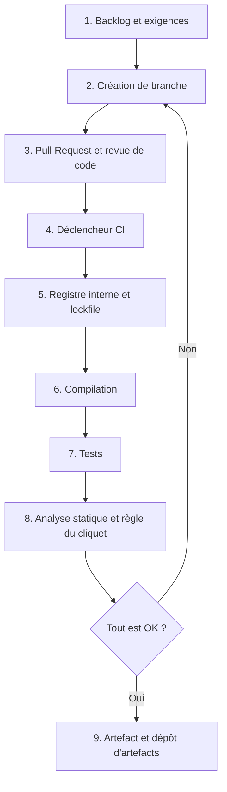

# Exercice 10 – Cycle de vie d'une fonctionnalité

## Description des étapes

1. **Backlog et exigences** : la fonctionnalité est décrite (user story, critères d'acceptation) et priorisée dans le backlog avant d'être développée.

2. **Création de branche (isolation)** : le développeur crée une branche `feature/...` à partir de `main`. Il travaille isolé, sans risquer de casser le code des autres.

3. **Pull Request et revue de code** : une fois le développement terminé, il pousse sa branche et ouvre une Pull Request. Un collègue relit le code avant qu'il soit fusionné dans `main`.

4. **Déclencheur CI** : le push ou l'ouverture de la PR déclenche automatiquement le pipeline (`on: push` / `pull_request`). Un agent de build démarre sur une machine propre.

5. **Registre interne et lockfile** : l'agent installe les dépendances avec `npm ci`. Il utilise exactement les versions du lockfile (`package-lock.json`), téléchargées depuis le registre interne de l'entreprise. Le build est donc reproductible.

6. **Compilation** : le code est compilé / buildé. S'il y a une erreur, le pipeline s'arrête immédiatement.

7. **Tests** :
   - *Unitaires* : testent chaque fonction séparément.
   - *Intégration* : testent plusieurs parties qui fonctionnent ensemble.
   - *SAST* : analyse le code source pour trouver des failles de sécurité.
   - *DAST* : attaque l'application en cours d'exécution pour trouver des failles.

8. **Analyse statique (SonarQube) et règle du cliquet** : les rapports sont envoyés à SonarQube, qui mesure la qualité du code (bugs, duplication, couverture). Si le nouveau code fait baisser la qualité, la règle du cliquet bloque la PR. Si une étape échoue, le développeur corrige sur sa branche et le cycle recommence.

9. **Artefact et dépôt d'artefacts** : si tout est vert, la PR est fusionnée et le pipeline produit le livrable (`.zip`, `.dll`...). Cet artefact est stocké dans un dépôt d'artefacts (GitHub Artifacts, Nexus, Artifactory), jamais dans Git. Il est prêt à être déployé.
